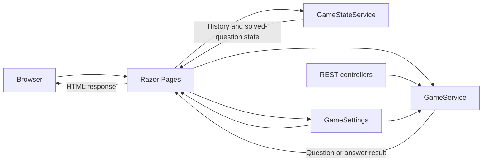
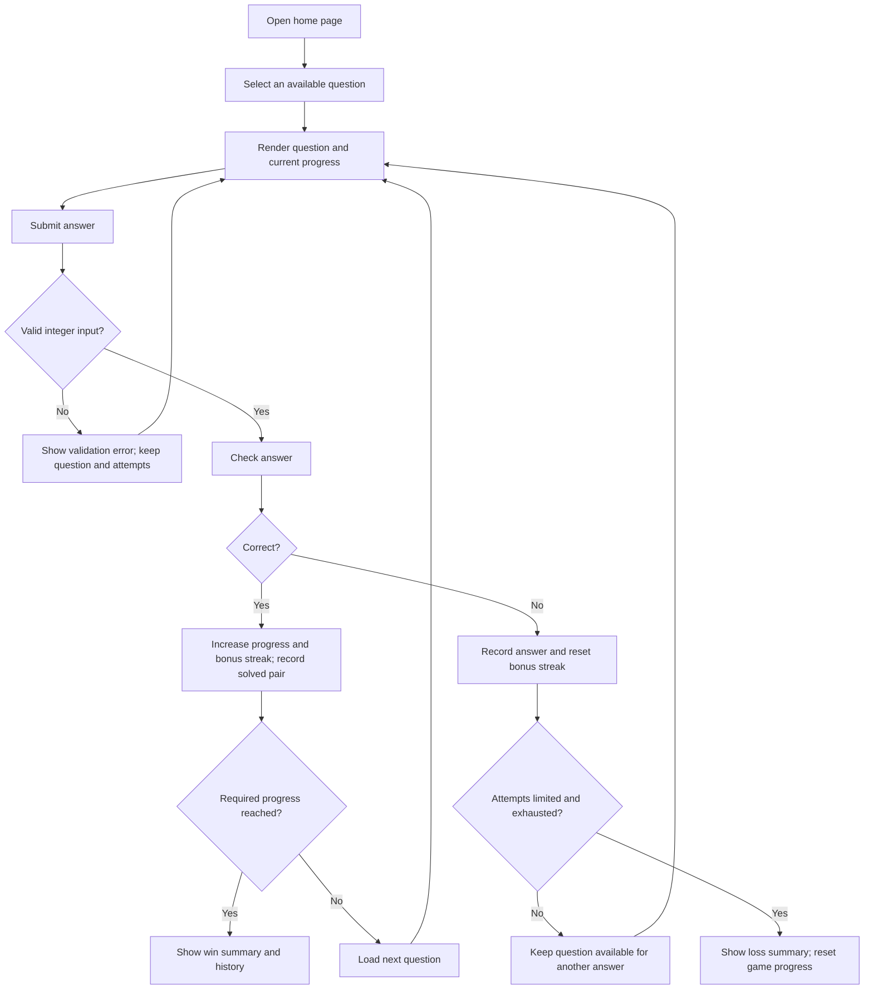
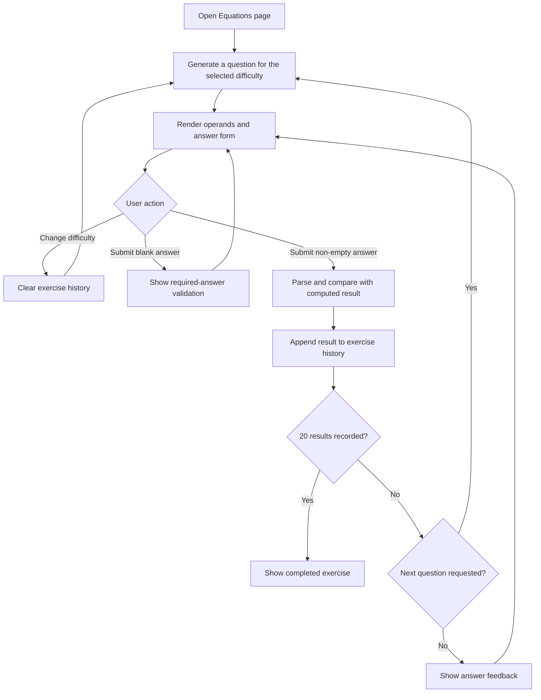

# Application Guide

MultiplicationGame is an ASP.NET Core Razor Pages application for practicing multiplication and basic arithmetic. The web project and its test project target .NET 10. The application has no database: game progress is posted back to the server in form fields and is not saved as a user profile or durable record.

## Pages and features

| Page | Route | Purpose |
| --- | --- | --- |
| Home | `/` | Multiplication practice with a progress target, attempts, and answer history. |
| Equations | `/Equations` | Addition, subtraction, multiplication, and division exercises at three difficulty levels. |
| Diagnostics | `/Diagnostics` | Displays the active environment and selected `GameSettings` values. |
| Privacy | `/Privacy` | Privacy information. |

The `/MemoryGame` route currently redirects to the home page.

## Architecture

`Program.cs` registers Razor Pages, controllers, `IGameService`, `IGameStateService`, and configuration-bound `GameSettings`. Razor Pages use the services directly; the multiplication and probability controllers also expose HTTP API endpoints.



The page state is carried between requests in form fields, including hidden inputs. It is not stored in a server-side session or database.

## Multiplication game

The home page generates a multiplication question, validates an integer answer, checks it through `GameService`, and renders the updated game state. Correct answers are added to the solved-question list; incorrect answers are recorded in the history and consume an attempt when attempts are limited.



### Question selection

`GameService` builds candidate factor pairs from the configured level. For the usual level `100` and `DefaultMaxMultiplier` of `10`, both factors are between 1 and 10 and their product cannot exceed 100. A pair already solved in the current game is excluded; operand order is part of the pair key, so `3-4` and `4-3` are distinct entries.

When both candidate groups are non-empty, pairs containing a configured `LowProbabilityFactors` value are selected from a separate, less-frequent group. `LowFactorChancePercent` controls the chance of selecting that group. If either group is empty, selection is uniform across the available questions.

### Progress and attempts

- A correct answer increases the displayed progress and the bonus streak. A wrong answer resets the bonus streak and consumes one attempt when `InitialAttempts` is greater than zero.
- Reaching `BonusAttemptsThreshold` correct answers without an intervening wrong answer grants one extra attempt and resets the bonus streak.
- Exhausting all attempts ends the game and resets the overall progress. With `InitialAttempts` set to `0`, attempts are unlimited.
- The configured target is controlled by `RequiredCorrectAnswers`. The current production configuration sets it to 20; `appsettings.Development.json` overrides it to 3.
- Answer history includes both correct and incorrect answers for the current game. It is submitted with the form and is not durable storage.

## Equations exercises

The `/Equations` page generates one operation at a time. Changing the difficulty resets the exercise history; submitting a non-empty answer records a result, and selecting the next question generates another problem until 20 results have been recorded.

| Difficulty | Addition and subtraction | Multiplication | Division |
| --- | --- | --- | --- |
| 1 | Values from 0 to 10; subtraction stays non-negative. | One factor is 2-5 and the other 1-5. | Divisors 2-5 with quotients 1-5. |
| 2 | Values from 0 to 50; subtraction stays non-negative. | Factors from 2 to 10. | Divisors 2-10 with quotients 1-10. |
| 3 | Values from 0 to 200; subtraction stays non-negative. | Factors from 2 to 20 and 2 to 12. | Divisors 2-12 with quotients 1-20. |

Division questions are generated with whole-number quotients. Answer parsing accepts integers and decimal values, using either `.` or `,` as the decimal separator.



## HTTP endpoints

The browser-facing Razor Pages do not need the REST endpoints; these are available for API clients and diagnostics.

| Method and route | Description |
| --- | --- |
| `GET /api/multiplication/question?level=100&solved=` | Returns a question as JSON (`a`, `b`, and `level`). Pass solved pair keys separated by semicolons to exclude them. |
| `POST /api/multiplication/answer` | Checks an answer. JSON body: `{"a":3,"b":4,"userAnswer":12}`. Returns `isCorrect` and `correct`. |
| `GET /api/probability/sample?level=100&iterations=1000` | Samples generated questions and reports observed low-factor frequency. Iterations must be from 1 to 20,000 and the level must be configured. |
| `GET /api/probability/pair-stats?level=100&iterations=10000` | Reports sampled unordered-pair and operand-orientation statistics. Iterations must be from 1 to 20,000 and the level must be configured. |

`POST /api/mode` and `GET /api/fragment` are compatibility endpoints for the removed learning mode and return HTTP 410.

## Configuration

Game options are bound from the `GameSettings` section in `appsettings.json`; `appsettings.Development.json` can override them. The table shows the base `appsettings.json` values, not the fallback property defaults in `GameSettings`.

| Setting | Purpose | Base `appsettings.json` value |
| --- | --- | --- |
| `Levels` | Allowed multiplication question levels. | `[100]` |
| `DefaultMaxMultiplier` | Maximum factor used for levels other than 1000. | `10` |
| `LowProbabilityFactors` | Factors placed in the less-frequent question group. | `[1, 2, 3, 5, 10]` |
| `LowFactorChancePercent` | Chance of selecting from that group when both groups exist. | `10` |
| `RequiredCorrectAnswers` | Progress target for winning the multiplication game. | `20` (`3` in Development) |
| `InitialAttempts` | Attempts at the start of a game; `0` means unlimited. | `3` |
| `BonusAttemptsThreshold` | Correct answers without a mistake needed to earn an extra attempt. | `5` |

The `/Diagnostics` page displays the active environment and selected settings, which is useful when checking environment-specific overrides.

## Run, build, and test

Install the .NET 10 SDK. From the repository root, start the HTTP launch profile:

```sh
dotnet run --project MultiplicationGame.csproj --launch-profile http
```

This profile serves the application at <http://localhost:5000>. Restore, build, and run tests with:

```sh
dotnet restore tests/MultiplicationGame.Tests/MultiplicationGame.Tests.csproj
dotnet build tests/MultiplicationGame.Tests/MultiplicationGame.Tests.csproj --no-restore
dotnet test tests/MultiplicationGame.Tests/MultiplicationGame.Tests.csproj --no-build
```

The test project references the web project. `MultiplicationGame.sln` currently contains only the web project, so target the test project directly when running the test suite.
