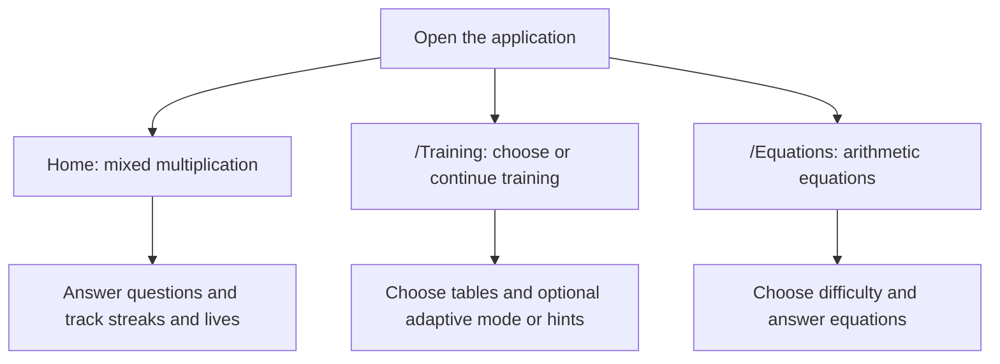
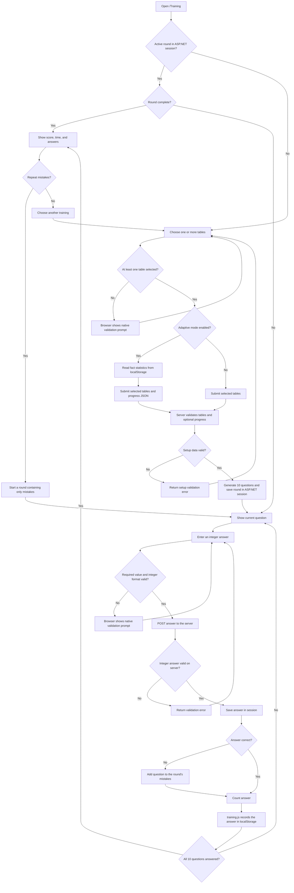
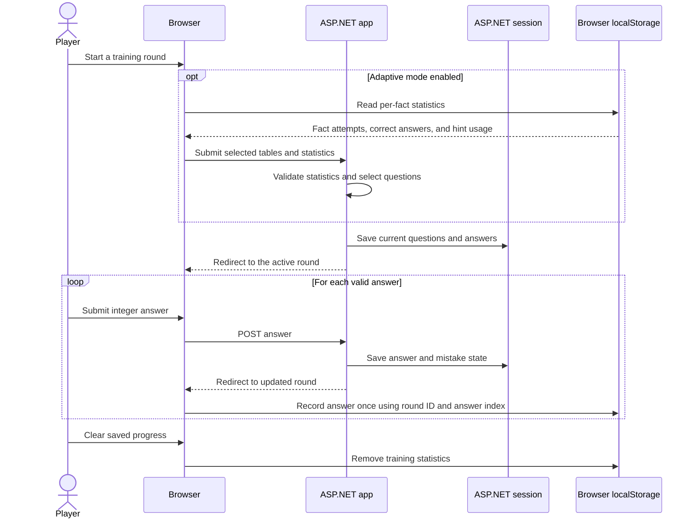
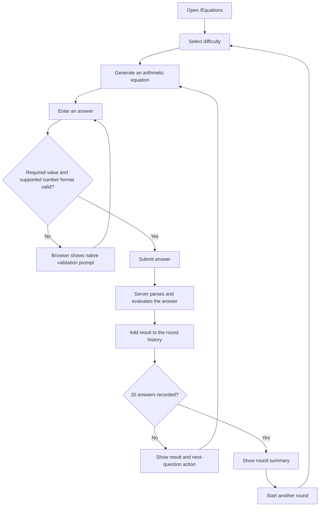
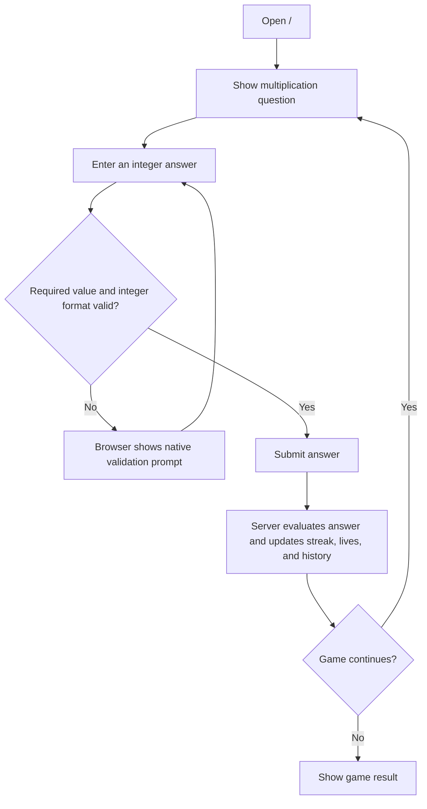

# Application processes and flows

These diagrams describe the current Razor Pages implementation.

## Choosing a game mode

## Training round

## Progress data

## Equations round

## Home mixed multiplication

